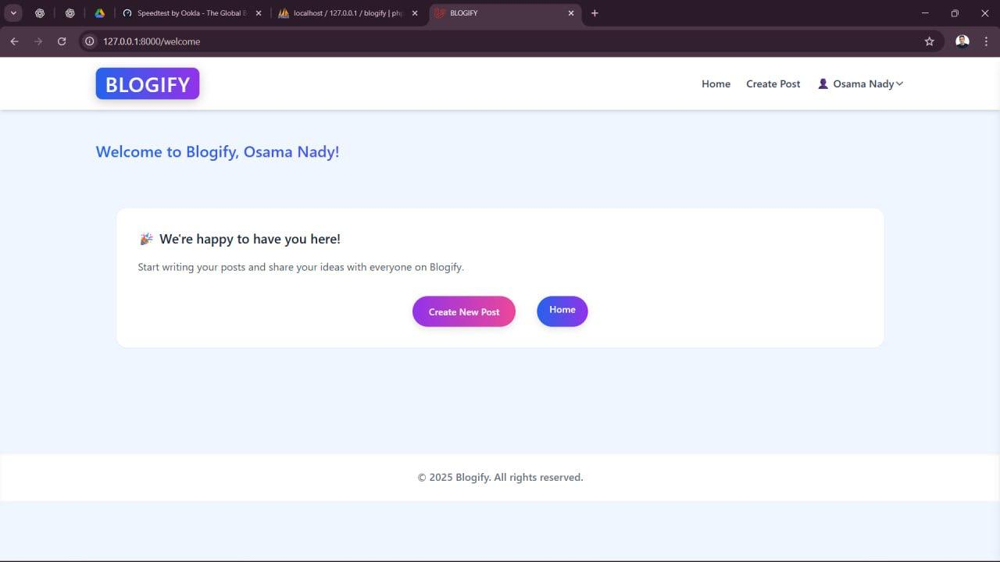
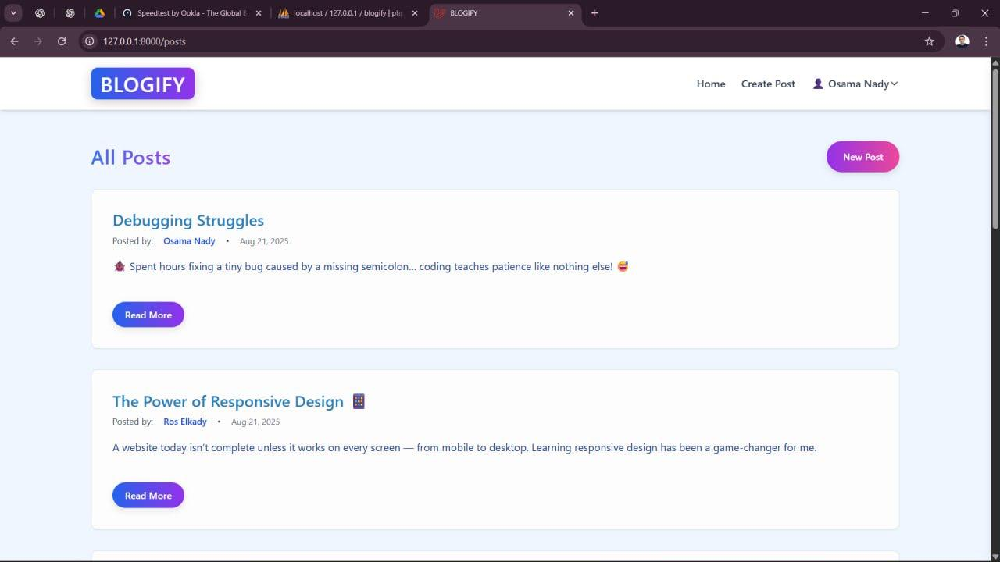
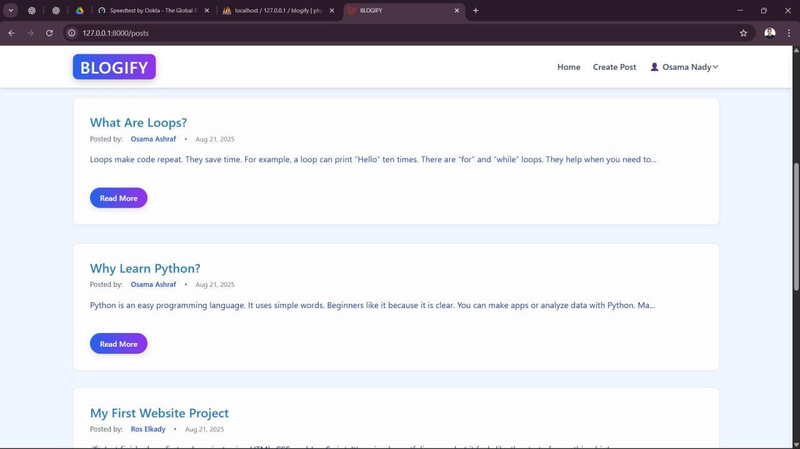
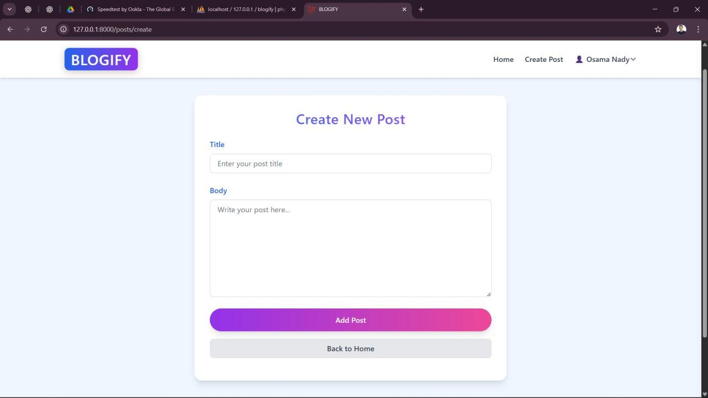
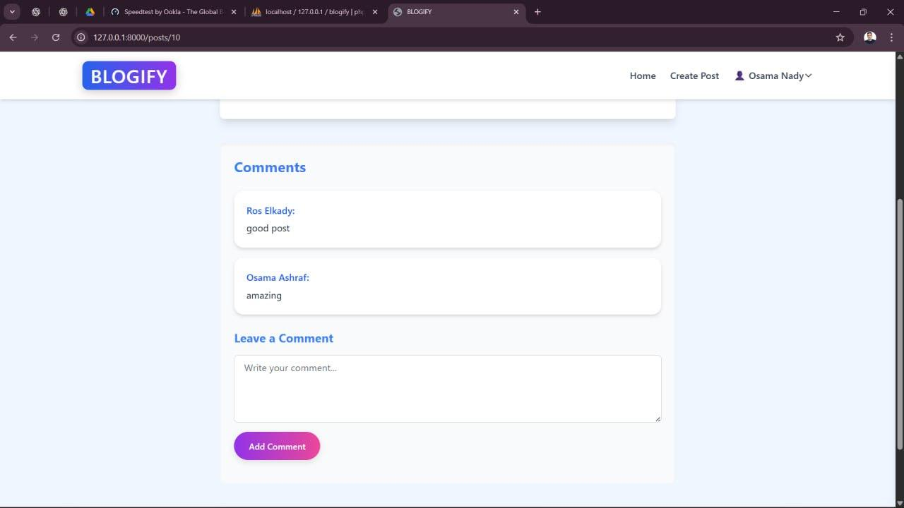

# BLOGIFY — A Modern Blogging Platform

A web-based blogging platform built with **Laravel, PHP, Blade, MySQL, Tailwind CSS, and Vite**. BLOGIFY provides a place for users to publish articles, interact through comments, and manage their profiles through a clean web interface.

---

## 📸 Screenshots

### Welcome Page


### Home Page


### Articles


### Article Details


### New Post


### Comments


---

## ✨ Features

* **Article Management** — Create, view, and manage articles.
* **Comments** — Interact with articles through comments.
* **Authentication** — User authentication for accessing account-related features.
* **User Profiles** — Personal profiles for users.

---

## 🛠️ Tech Stack

| Technology   | Purpose                                 |
| ------------ | --------------------------------------- |
| PHP          | Backend programming language            |
| Laravel      | Web application framework               |
| Blade        | Server-side templating                  |
| MySQL        | Relational database                     |
| Tailwind CSS | Utility-first CSS styling               |
| Vite         | Frontend asset bundling and development |

---

## 🚀 Getting Started

Follow these steps to run BLOGIFY locally.

### Prerequisites

Make sure you have the following installed:

* PHP
* Composer
* MySQL
* Node.js and npm

### 1. Clone the Repository

```bash
git clone https://github.com/BinNady/BLOGIFY.git
cd BLOGIFY
```

### 2. Install Dependencies

Install the PHP dependencies:

```bash
composer install
```

Install the frontend dependencies:

```bash
npm install
```

### 3. Configure the Environment

Create your local environment file:

```bash
cp .env.example .env
```

On Windows Command Prompt, you can use:

```cmd
copy .env.example .env
```

Generate the application key:

```bash
php artisan key:generate
```

### 4. Configure the Database

Create a MySQL database for BLOGIFY, then update the database settings in your `.env` file:

```env
DB_CONNECTION=mysql
DB_HOST=127.0.0.1
DB_PORT=3306
DB_DATABASE=blogify
DB_USERNAME=root
DB_PASSWORD=
```

Adjust the database name, username, and password to match your local MySQL configuration.

### 5. Run Database Migrations

```bash
php artisan migrate
```

### 6. Build Frontend Assets

For development:

```bash
npm run dev
```

Alternatively, build the production assets:

```bash
npm run build
```

### 7. Start the Application

```bash
php artisan serve
```

Open the local URL shown in your terminal, usually:

`http://127.0.0.1:8000`

> **Note:** Keep `npm run dev` running in a separate terminal during local frontend development. Use `npm run build` for a production asset build.

---

## 📂 Project Structure

```text
BLOGIFY/
├── app/
│   ├── Http/
│   │   └── Controllers/
│   └── Models/
├── database/
│   └── migrations/
├── public/
├── resources/
│   ├── css/
│   ├── js/
│   └── views/
├── routes/
├── tests/
├── .env.example
├── artisan
├── composer.json
├── package.json
└── README.md
```

---

## 👨‍💻 Author

**Osama Nady — Bin Nady**

* GitHub: [@BinNady](https://github.com/BinNady)

---

## 📄 License

This project is available in this repository. Please check the repository's license information before redistributing or reusing the code.
